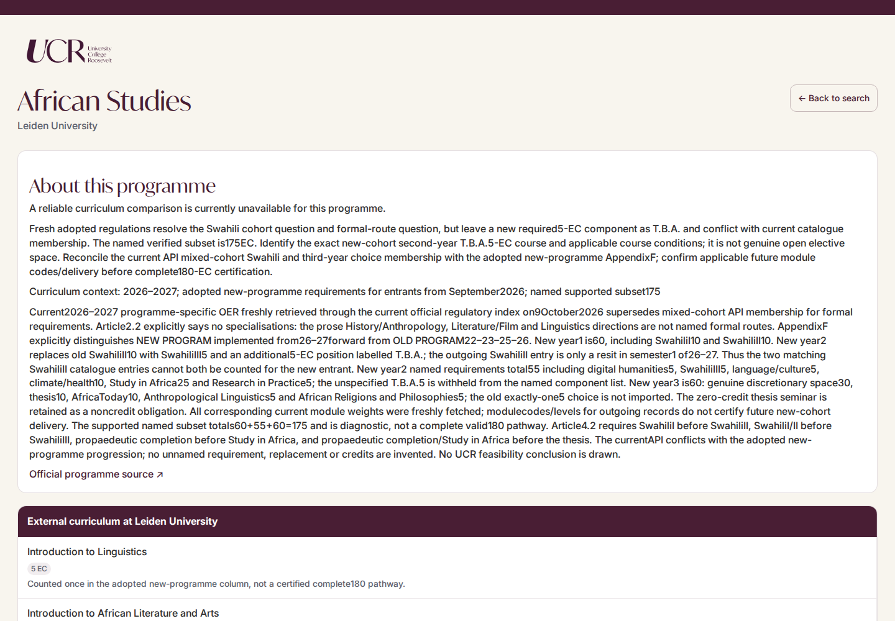
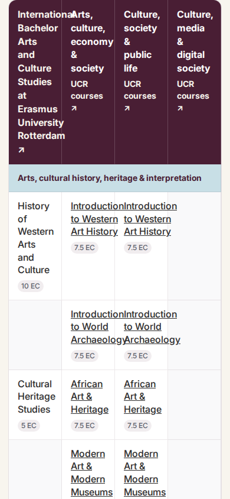

# Comprehensive counselor re-audit: preparation and findings

Date: 17 October 2026. Baseline: `bb2c4b5bd41e060b501448e057757f661ef22d4e` on `main`.

Status: the initial preparation and first-pair review are complete; their dated findings remain below. The integrated-workflow preparation is appended at the end. Counselor academic records, programme-interest data, application code and presentation settings remain unchanged. The earlier alignment pilot is a separate historical exercise.

Deliverables: [operational protocol](counselor-comprehensive-reaudit-protocol.md), this inventory and architecture diagnosis, the pilot below, and an initial [review register](../../data/counselor/qc/comprehensive-reaudit.json). Counts come from the baseline files, not historical report summaries. Inventory inspection is not stage approval.

## Current corpus

| Item | Baseline count/status |
|---|---:|
| Permanent normalized targets | 460 |
| In-scope targets and active canonical records | 438; exact ID sets agree |
| Comparisons | 391 |
| Exceptions | 47 |
| Unresolved external programmes | 32 |
| No-defensible-UCR-match exceptions | 15 |
| Pending UCR assessments / registry exceptions | 0 / 0 |
| UCR alternatives | 967: 39 comparisons with one, 128 with two, 224 with three |
| Root production decision files | 433; all v2 |
| Canonical schema version | All 438 use 2.0 |
| Presentation modes | 302 normal; 89 caution; 47 external-only |
| Registry programme-interest rows | 22,259 |
| Current review indexes | 438 programmes; 21,212 linked interest rows |
| Final production discovery indexes | Absent, as required before finalisation |

The five early canonical records CP001–CP005 have no root decision file. Regression fixtures for CP004/CP005 are not active production inputs. These five records are still in scope; any later repair must acknowledge its actual input path and cannot claim a root v2 replay. There are no orphaned active decisions or missing in-scope canonical records.

Twenty-two targets are excluded by the existing scope rule: 18 joint/double/dual targets and four standard targets without current production eligibility. Archived decision/comparison pairs exist for CP134, CP199 and CP333 under `data/counselor/withdrawn/`; retain them as evidence, not active corpus entries. CP333 also has an unresolved combined-study-load question in historical remediation; it does not add a 33rd unresolved active exception.

The current enriched workbook was retrieved in the checkout, opened successfully and inspected: 151 data rows, 26 columns, including enriched profiles, topics/methods, prerequisites and planned terms. Its blob is `c2bcc3b63ec7831fd0f7b8ddfb32de1260521655`. This preparation does not independently validate any selected course or schedule.

## Existing reviews and what survives

The historical labels “stage 1” and “stage 2” below refer to earlier projects, not the six stages of the new protocol.

| Existing evidence | Recorded extent and result | Reuse and limitation |
|---|---|---|
| `qc/stage1-completeness-exceptions.json`; `docs/qc/counselor-completeness-exceptions-stage1.md` | 159 audited populations: 140 exceptions and 19 scope exclusions; no pending entries | Identity/curriculum findings, source references and initial failure mechanisms. Its 441-record baseline is historical. |
| `qc/stage1-remediation.json`; matching Markdown report | 97 processed cases: 64 resolved, 24 partially resolved, nine corrected with research pending | Preserve implemented factual/registry corrections and specific open questions. Thirty-three historical cases with remaining research comprise 32 active unresolved exceptions plus withdrawn CP333. |
| `qc/stage2-ucr-assessment.json`; matching report | 50 assessments: 35 comparisons and 15 no-match decisions; includes the first ten and subsequent fixed queue of 40 | Reuse research, concepts and explicit choices after verification. Its corpus totals precede later no-match reversals. |
| `qc/stage2-ucr-quality-control.json`; matching report | All ten earlier UCR assessments reviewed; none remain in that queue | Course/interest/feasibility findings are useful evidence, not full audience-quality approval. |
| `qc/stage2-preexisting-no-match-review.json`; matching report | All 55 reviewed: 54 replaced by comparisons, one retained no-match | Preserve candidate/course evidence and reasoned decisions. Do not presume either reversals or the retained judgment correct. Completion metadata records that automation as disabled; no schedule is created or changed here. |
| `docs/qc/counselor-comparison-qc-pilot-2026-10-17.md` | Six comparisons, 12 alternatives; alignment/coherence diagnostic | Keep unchanged. It did not include African Studies or cover the new six-stage scope. |
| `docs/qc/counselor-comparison-qc-follow-up-2026-10-17.md`; `qc/alignment-review-2026-10-17.json` | Five repaired pairs: CP019, CP035, CP330, CP435, CP459. Nine cases/21 programmes/504 placements received recorded independent workbook feasibility checks | Reuse exact corrected alignments/rationales and check evidence. Not fresh certification of every external curriculum or the rendered experience. Four external-content questions remain. |
| `docs/quality-control/2026-09-11-audit.md` | Earlier project audit | Historical context, not approval of the current counselor corpus. |

Four detailed-content follow-ups remain in the alignment register: CP004 `psy-ethics` and `psy-science-practical`, CP009 `b3-ethics`, CP035 `bio2-philosophy`. Their rows were retained because material error had not been established; detailed external-syllabus certification was explicitly withheld. Carry those questions forward without calling them confirmed errors or silently closing them.

The active unresolved IDs are listed below. These figures are stored component totals, not fresh curricular judgments. Five unresolved records already total 180 EC (CP266, CP309, CP322, CP404, CP416); credit closure cannot resolve cohort, prerequisite or authority conflicts.

| ID | Stored external programme | Stored EC |
|---|---|---:|
| cp-000040 | German Language and Culture | 165 |
| cp-000051 | Human Neuroscience | 164 |
| cp-000099 | Health and Life Sciences (Gezondheid en Leven) | 90 |
| cp-000100 | Health Sciences (Gezondheidswetenschappen) | 150 |
| cp-000149 | General Cultural Studies (Algemene Cultuurwetenschappen) | 0 |
| cp-000250 | Bachelor Clinical Technology | 181 |
| cp-000263 | Bachelor Architecture, Urbanism and Building Sciences | 175 |
| cp-000266 | Bachelor Industrial Design | 180 |
| cp-000275 | Bachelor Theology | 60 |
| cp-000277 | African Studies | 175 |
| cp-000278 | Archaeology | 90 |
| cp-000283 | Chinese Studies | 190 |
| cp-000284 | Criminology | 120 |
| cp-000286 | Cybersecurity & Cybercrime | 150 |
| cp-000288 | German Language and Culture | 175 |
| cp-000289 | Economics & Society | 120 |
| cp-000290 | English Language and Culture | 120 |
| cp-000293 | Tax Law | 120 |
| cp-000295 | Medicine | 120 |
| cp-000300 | Italian Language and Culture | 170 |
| cp-000306 | Middle Eastern Studies | 175 |
| cp-000309 | Dutch Studies | 180 |
| cp-000311 | Notarial Law | 120 |
| cp-000312 | Ancient Near Eastern Studies | 155 |
| cp-000314 | Political Science | 60 |
| cp-000317 | Law | 120 |
| cp-000318 | Religious Studies | 60 |
| cp-000322 | South and Southeast Asian Studies | 180 |
| cp-000324 | Linguistics (Taalwetenschap) | 175 |
| cp-000364 | Politiek, cultuur en religie | 172.5 |
| cp-000404 | Hebrew Language and Culture (Hebreeuwse taal en cultuur) | 180 |
| cp-000416 | Musicology (Muziekwetenschap) | 180 |

## Reusable infrastructure and its limits

- `data/registry/` provides stable identities, production order, provenance crosswalks, resolution decisions/sources and complete target-linked interests. The guarded corrections ledger and withdrawn archives preserve earlier identity decisions.
- `data/counselor/decisions/` holds explicit academic inputs. Existing v2 compilation and regression fixtures can reproduce mechanical structure; they do not independently decide course relevance, curriculum validity or communication quality.
- `data/schema/counselor-comparison.schema.json`, `counselor-final-methodology.schema.json`, `counselor-exception.schema.json` and the shared example schema describe current contracts. Runtime checks live in `scripts/validate-counselor-{comparison,structural-rules,final-rules}.mjs`; `npm run validate:counselor` orchestrates them through temporary storage and the optional-research handling.
- The validators check identity, coverage, references, counts, traceability structure and declared methodology. They do not inspect official sources or independently read workbook prerequisites/term availability, nor establish that a rationale or programme description is true.
- `presentation-overrides.json` separates presentation from academic status. Normal/caution are historical provenance categories, not quality judgments; the generic caution message must not stand in for a case-specific verified limitation.
- `review-programmes.json` / `review-interests.json`, their builder/checker, Shiny tests and deployment bundle checker remain reusable. `pilot/shiny/data/courses/*.json` supplies clickable UCR descriptions; its correspondence with workbook evidence also needs review when material.
- The repair Action accepts one active root decision repair with its regenerated canonical file per commit. A two-case review batch therefore need not be one two-decision commit. No new compiler or audit service is needed.

Preparation checks: `npm run validate:counselor` passed across the unchanged corpus; `npm run validate:counselor-review` confirmed the 438-programme/21,212-interest indexes. These are mechanical baseline results, not completed re-audit findings.

## User-facing/internal-content diagnosis

The root failure is that some required evidence fields also serve as display prose. The exception schema/validator requires nonempty `reason`, `curriculumContext`, `academicYear` and `sourceNotes`, but imposes no audience boundary. The compiler preserves research text, and the renderer displays it. Rewriting isolated records would leave the mechanism intact.

| Current field or source | Actual display path | Diagnosis and proposed handling |
|---|---|---|
| Discovery `displayName`, institution, matched interest text | `render_result_cards`; English search indexes | Intended audience content. Review exact target naming and interest claims; preserve provenance separately. |
| `comparator.name`, institution, `primarySourceUrl`; `programmes[].label` | Page headings, comparator table header/link; shared `visible_label` | Intended labels/sources. `visible_label` uses canonical comparator names rather than the registry English display name, and can generate generic labels. Check these paths, not only search names. |
| `comparator.route` | Comparison summary and exception pathway line | Material pathway choice should remain visible in readable form. Keep route-selection reasoning internal. |
| `academicRationale.alternatives[].concept` | `render_comparison_summary` | Existing field already supplies descriptions. Review and retain good text; do not create a competing concept field. |
| Block titles; comparison-cell `text`, EC, emphasis | `render_compare_table` | Intended academic display. Preserve verified course/component names, gaps and credits. |
| `blocks[].rows[].cells.*.note` | Beneath comparison cells | Mixed audience/evidence role. CP019 includes “First-listed Culture and Economics focus-area course.” Review case notes; route-selection bookkeeping is not a curriculum explanation. |
| `notes[].text` where placement is absent or `comparison` | Shared `render_comparison_notes` | Audience-intended explanatory notes. The permissive missing-placement fallback is part of the surface to check. Preserve warranted limitations. |
| `exception.reason` | Paragraph under “About this programme” | Contains academic production reasoning as well as potentially useful reasons; CP119 explains concept testing and assembly. Preserve the decision evidence and supply a concise audience explanation separately. |
| `exception.curriculumContext` | Same exception summary | Often duplicates long reconstruction logs. Retain internally; do not render as a programme description. |
| `comparator.academicYear` | Exception “Curriculum context” line | Currently unrestricted prose; e.g. CP278 combines year, entrant status, known EC and unresolved requirements. Display a clean year/cohort label and a separate material limitation. |
| `comparator.components[].name`, EC and `.note` | Exception/external-only component table | Notes include internal catalogue/cohort evidence. A diagnostic list may total 190 EC (CP283) or only 175 EC (CP277); do not present it as a complete certified pathway. Preserve supported/diagnostic evidence internally. |
| `comparator.sourceNotes` | Exception/external-only transparency panel | Direct research-log exposure. CP277/278/283/306 are concrete examples. Keep URLs accessible with ordinary link labels; preserve full reconciliation internally. |
| Presentation mode/message | Caution banner or withheld-comparison explanation | Separate presentation concern. Do not use it to overwrite an academic decision or house the entire academic description. |
| Course-description JSON, selected by code | `course_description_dialog` | User-facing course evidence; inspect accuracy and fallback message, not just canonical record wording. |

`render_exception(..., presentation_only=TRUE)` suppresses `exception.reason` and `curriculumContext` but still renders academicYear, component notes and sourceNotes. Thus hiding UCR columns does not solve disclosure. Ordinary comparison pages do not currently render comparator sourceNotes/academicYear directly; they expose concepts, cell notes and comparison notes instead. This distinction matters when estimating migration work.

Content counts identify scale, not defect prevalence: 408 records have component notes; 365 have comparison-cell notes; 390 have displayed comparison notes. Each needs audience review where it reaches a surface. The counts do not imply every note is defective.

### Proposed remedy: review before implementation

Keep internal research where it is; define explicit audience fields and an allowlist for rendering. Reuse existing intended display fields (labels, concepts, comparison notes) after review. For mixed exception/metadata/component notes, add the smallest explicit audience contract to the existing decision → canonical pipeline, provisionally a canonical `audience` object with programme description, limitation/explanation, clean curriculum label and component-note mapping by stable ID. The exact field names and requiredness remain a design choice, not an implemented contract. Research detail remains in the existing internal fields and QC evidence.

The renderer should use approved audience fields and ordinary academic facts only. It must never fall back from missing audience copy to `sourceNotes`, `curriculumContext`, mixed `reason` or arbitrary notes. A missing field should yield a neutral status-specific message or omit optional prose, while preserving any material academic limitation in approved copy. An unresolved diagnostic list should be withheld or explicitly marked incomplete/uncertified; do not silently call all its entries verified requirements. No generative rewriting at runtime.

This is a targeted extension of existing records/compiler/renderers, not a second comparison corpus or a description sidecar in presentation overrides. A later contract change must cover decision inputs, compiler, schemas/manual validators, repair workflow, app/shared helpers, fixtures and deployment bundle. Student concepts already have an established canonical display role and should remain intact.

## Six-case pilot

| Pair / case | Current state | Why it is included |
|---|---|---|
| 1 — CP277, Leiden African Studies | External unresolved; 175 EC; external-only | Mandatory case. Tests cohort separation, duplicated Swahili, unresolved required credits, preservation of corrected evidence and severe internal-note exposure. |
| 2 — CP119, VU Theology and Religious Studies | No defensible match; 180 EC; external-only | Tests independent reconsideration of a retained no-match, an exact part-time/route identity and readable explanation of substantive coverage gaps. Earlier ten-case QC is evidence, not approval. |
| 2 — CP001, Erasmus Public Administration | Original comparison; two alternatives; normal | Positive control: prior alignment review found no material error. Tests preservation of sound work and the early-record path without a root decision. |
| 1 — CP019, Erasmus Arts and Culture Studies | Recently repaired comparison; three alternatives; normal | Tests preservation of corrected matches, bounded route choices, internship/thesis distinctions, relative academic emphasis and audience quality beyond mechanical validity. |
| 3 — CP035, Radboud Biology | Recently repaired comparison; three alternatives; normal | Natural-science breadth, ecological versus biomedical purposes, explicitly provisional prospective curriculum and the still-open ethics-content question. Tests source-year handling and downstream restraint. |
| 3 — CP330, Twente Mechanical Engineering | Reassessment comparison; one alternative; caution | Tests separately credited units versus parent modules, specialist engineering gaps, a restrained related-fields concept and whether the caution text accurately explains this case. |

This selection covers all three presentation modes and one/two/three alternatives. It is purposive, not representative: do not estimate corpus error rates from it. CP278, CP283 and CP306 remain documented diagnostic examples for the common renderer, not additional pilot reviews. A temporary in-memory external-only setting for an otherwise normal pilot comparison can exercise the withheld-comparison branch without changing the committed settings.

## Remaining choices and immediate action

The six-stage order, preservation principle, four outcomes and two-case batches are settled by this assignment. The existing academic matching standard, route rule, feasibility constraints and presentation/academic separation remain unchanged.

Three implementation choices remain: the precise audience-field contract and migration of mixed notes; whether to withhold unresolved diagnostic component lists or display them with an explicit incomplete/uncertified label; and how to record independent final-review and rendered evidence consistently. The recommended defaults are an explicit canonical audience extension, withholding uncertified diagnostic lists while showing supported programme information and a clear limitation, and compact source-linked review observations plus identified viewport screenshots. None is implemented here.

The preparatory recommendation was to review CP277 and CP119 first. On 17 October the user instead approved CP277 and CP019 as the first pair; the findings below implement that sequence. Record academic and communication findings without granting final approval through the known renderer defect. Use the pilot's actual content needs to settle the audience contract, implement the shared remedy once when authorised, then complete all six cases before beginning the 216 subsequent pairs. No corpus-wide run, recurring task or application deployment is started by this preparation.

## Pilot pair 1 — CP277 and CP019

Reviewed 17 October 2026 against input commit `ffabf196b0702eba9acbec57f6aa5f954af16a94`. The user approved the protocol and changed the sequence to **CP277 + CP019**, then **CP119 + CP001**, then **CP035 + CP330**. All six cases remain selected. The next pair must wait until these findings have been reviewed.

Both cases are `reviewed-with-blockers`; neither has final academic/presentation approval. This review changes the register, report and pilot sequence only. All proposed record, registry, description-cache, layout and architecture repairs remain unimplemented. Earlier reports remain historical evidence.

### Results across the six stages

| Stage | CP277 African Studies | CP019 Arts and Culture Studies |
|---|---|---|
| 1. External identity/curriculum | **Blocked.** Retain corrected 175-EC named subset; required 5 EC still unnamed. | **Retain.** Complete minor pathway and component accounting supported; note detailed-course evidence limit below. |
| 2. Programme interests | **Correct.** All 63 rows examined; 43 retained, 14 need bounded correction, six career attributions remain blocked. | **Correct.** All 58 rows examined; 51 retained, five need attribution/source corrections, two illustrative examples remain blocked. |
| 3. Comparability/concepts | **Blocked.** Preserve external-unresolved status; do not convert it to a no-match. | **Correct.** Retain three distinct organising concepts; repair the unaccounted arts/health candidate and narrow specialist claims. |
| 4. Courses/schedules/comparison | **Blocked.** No UCR schedules exist; no complete comparison can be approved. Supported external components remain. | **Correct.** All 72 placements pass hard constraints. Preserve most course choices and existing alignment corrections; adjudicate one course contribution and narrow some rationales. |
| 5. User-facing explanations | **Reconstruct the audience explanation.** Preserve the research internally. | **Correct.** Tighten concepts and cell notes; reconcile two course modals with available evidence. |
| 6. Rendered experience | **Blocked.** Actual desktop/mobile review confirms research-log exposure and an insufficiently labelled partial curriculum. | **Blocked.** Actual review confirms content defects and overlapping mobile comparison columns. |

These outcomes distinguish an academic structure needing reconstruction from defective copy. There is no basis here to regenerate either case wholesale. CP277's explanation needs rebuilding; its independently confirmed academic components do not.

### Evidence and limits of verification

The review independently downloaded and inspected the applicable Leiden programme-specific regulations, Erasmus 2026–2027 TER, current programme/overview/career pages, Leiden's current BA-AFR response and 22 linked module records. The Leiden Appendix F table was also inspected visually. Retrieval metadata and hashes are preserved in the detailed [CP277](../../data/counselor/qc/comprehensive-reaudit/cp-000277.json) and [CP019](../../data/counselor/qc/comprehensive-reaudit/cp-000019.json) review files linked from the central register. Programme-level pages retrieved through web search were used where a direct request returned 502. The current-linked Leiden curriculum image is under a **2025–2026** path; it cannot resolve the September-2026 entrant's requirements.

The complete enriched workbook was opened afresh in the current checkout. All 47 unique selected CP019 codes were read against profile/description evidence and their programme roles; all 72 scheduled placements were independently checked. This includes the description-only entry for Writing Art's Histories, not an invented missing outline. The former QC feasibility declarations were not the basis for these results.

The Erasmus linked detailed course guide returned an empty application shell. Formal programme requirements, general progression conditions and the current descriptive overview were available. This supports the reconstruction and bounded partial alignments below, but does **not** certify every detailed external course syllabus or possible course-specific admission restriction. No repeated unsuccessful catalogue search or inferred syllabus is represented as verification.

Primary sources:

- [Leiden African Studies regulations, 2026–2027](https://www.organisatiegids.universiteitleiden.nl/binaries/content/assets/geesteswetenschappen/oer/2026-2027/ba-oso-african-studies-2026-2027.pdf): articles 2.2–2.3, 2.9, 4.2 and Appendix F, pp.5–7.
- [Current Leiden programme catalogue response](https://studiegids.universiteitleiden.nl/api/product?code=BA-AFR&type=STUDY), the [programme page](https://www.universiteitleiden.nl/en/education/study-programmes/bachelor/african-studies) and [study-programme page](https://www.universiteitleiden.nl/en/education/study-programmes/bachelor/african-studies/about-the-programme/programme-structure).
- [Leiden programme career page](https://www.universiteitleiden.nl/en/education/study-programmes/bachelor/african-studies/after-graduation/career-prospects) and [further-study page](https://www.universiteitleiden.nl/en/education/study-programmes/bachelor/african-studies/after-graduation/continuing-your-studies).
- [Erasmus TER 2026–2027](https://www.eur.nl/en/eshcc/media/2026-08-ter-bachelor-eng-2026-2027): Appendix 7, arts.3.3–3.8/4.3–4.5 and Appendix 11; [programme overview](https://www.eur.nl/en/bachelor/international-bachelor-arts-and-culture-studies/programme-overview), [programme identity](https://www.eur.nl/en/bachelor/international-bachelor-arts-and-culture-studies) and [careers](https://www.eur.nl/en/bachelor/international-bachelor-arts-and-culture-studies/after-graduation).
- Current repository workbook blob `c2bcc3b63ec7831fd0f7b8ddfb32de1260521655`, canonical/decision pairs and actual app/shared-renderer blobs recorded in the register.

### CP277: preserve the correction, stop its downstream contamination

The formal table independently confirms the central correction. New entrants take one Swahili II component; the later same-named entry belongs to the outgoing curriculum. The new table supplies 60 EC in year 1, 55 named EC plus an unidentified required 5-EC position in year 2, and 60 EC in year 3. The existing 20 components therefore retain 175 identified EC. Swahili III belongs in year 2; both final-year subjects remain requirements rather than an outgoing either/or choice. The 30-EC discretionary component and 10-EC thesis can remain. Keep the zero-credit seminar documented without adding it to positive-credit totals.

The current catalogue still combines new first-year material with outgoing later-year membership. Its general description discusses three tracks, while the applicable formal regulations state no specialisations. The formal cohort table controls; neither an older diagram nor two catalogue codes can fill the missing requirement. Preserve the external-unresolved exception. This is a gap in the **external evidence**, not an academic finding that UCR cannot offer a related programme.

The interest review reveals that the earlier curriculum correction did not propagate into discovery evidence. Rows **12287–12289** still claim History and Anthropology, Literature and Film, and Linguistics as formal specialisations. Their subjects are legitimate programme interests, but their formal status must change. Retain the subject signals and stable row identifiers; remove the unsupported specialisation assertion and use the actual programme-level disciplinary evidence. Rows **12283/12307** also inflate the African Languages Lab's urban youth language work into general urbanisation/urban studies; narrow them to the evidenced linguistic subject.

The eight illustrative questions at **12318–12325** are plausible combinations of taught material, but their evidence falsely says that the university explicitly presents those exact projects. Separate careful inference from quotation/explicit attribution. Several require narrower details, including the city-specific environmental example. Six career claims at **12327–12332** remain unconfirmed for this exact bachelor: the current career page reports pooled Area Studies destinations. Do not relabel pooled evidence as African Studies alumni evidence. Row **12333** can retain postgraduate African Studies, but its anthropology/history destinations are not established by the current further-study list. The register accounts for all 63 rows individually; no missing-credit placeholder is treated as an interest generator.

A fresh workbook scan identifies substantial African art/heritage content and some Mediterranean/African connections, alongside generally related social/historical subjects. Those findings are insufficient to certify an Africa-centred 24-course response, and absence of Swahili at UCR alone would not prove a no-match. Do not construct alternatives until the external basis and corrected interest boundary support that assessment.

The current display requires a new audience explanation. Under “About this programme,” it shows instructions to identify a missing course, catalogue/API reconciliation, date/code fragments and a long curriculum investigation. The component table repeats audit notes; the later transparency panel repeats source documentation. Preserve those details internally. Readers need a short account of what African Studies studies and a separate, plain explanation of why a reliable full comparison is unavailable. The 175-EC diagnostic list must be explicitly incomplete or withheld; suppression of notes alone would not resolve its apparent completeness.

### CP019: retain the structure, repair bounded academic and communication claims

The current formal and programme sources support the stored identity, selected Culture and Economics focus and minor option. The webpage explicitly places one focus course in year 2 and two within the minor route's third-year option. That resolves the apparent overlap in the formal table: those two courses are counted within the three-course focus requirement, not added again. Retain all 26 components and the 180-EC reconstruction. The formal-source heritage label can remain despite its updated webpage title. Internship/thesis conditions are material; the programme requires completed first-year study before the internship and first-year plus 45 later EC before the graduation project. Do not imply that generic research or communication courses reproduce those compulsory experiences.

The three UCR organising purposes remain independently defensible: an integrated arts/cultural-economy composition; a society/public-life composition with substantially more history, law, ethics and institutions; and a media/communication composition. Their overlapping sets contain **13, 12 and six courses**; each programme contributes **11, 12 or 18 different courses** to the respective pair. These differences follow academic priorities, rather than swaps made merely to meet the numerical floor.

However, row **1098**, arts and health/wellbeing, is assigned to a combined societal-challenges candidate without showing how the current route implements the arts/health question or why a separate candidate was not pursued. General conflict, ethics, art and social research do not by themselves establish this connection. Preserve the official programme interest, which is explicit, but repair its candidate disposition. This is not evidence that an arts/health programme is impossible, and it does not justify inventing a fourth alternative or automatically removing either existing additional route.

All three schedules pass: **24 unique courses, 180 EC, six four-course semesters, Year-1 PPD, seven/six/seven advanced courses, and every formal prerequisite completed before the course and every assigned term marked available**. Advisory rhetoric progression is relevant: the first route includes Rhetoric in Action without introductory rhetoric, but the database specifies no formal prerequisite, so this is not a mechanical violation.

Most selections contribute actual art/literary/media study, social inquiry or specific economic/institutional perspectives. Two distinctions need clearer treatment:

- The sociology sequence teaches general theory, modernity and civil society, not the comparator's specialist cultural-sociology sequence. Retain the courses and their partial relationships; change the specialist wording in concepts/rationales.
- **MCCCOMM213 Rhetoric in Action** is a community education project in which students train primary-school children in speaking and debate, principally in Dutch. Its existing cultural-public-communication justification does not explain that specific contribution to this programme's organising purpose. Require a concrete academic justification within the existing concept, or replace this one course. Do not solve the issue by retrospectively inventing a new concept to accommodate it. Other alternatives do not depend on this course.

The [47-code review in the CP019 case file](../../data/counselor/qc/comprehensive-reaudit/cp-000019.json#/stages/4/courseReview) records actual roles, qualifications and programme membership. It preserves specific complementary study without pretending that every course teaches cultural-sector applications. For example, EU institutions and public economics can contribute to the public-life composition while remaining separate from specialist cultural-policy/cultural-industry components. Leadership study is only a partial organisational counterpart: it does not reproduce cultural financing or the complete cultural-industries formation.

Review of all **14 positive and 12 unmatched** decisions found no further confirmed material placement error. Retain meaningful partial correspondences and the recently corrected gaps for specialist cultural policy, advanced cultural economics, specialist management research and the mandatory thesis. Preserve the African heritage rematch: collection, museum acquisition and repatriation are directly evidenced. Keep the data-science/statistics relationship limited to actual data organisation/analysis/presentation, not a full SPSS or statistics syllabus. Detailed external syllabi remain unavailable; the more specific claims about cultural-organisation leadership should be narrowed rather than presented as full certification.

All 58 interest rows were examined. Core subjects, genuine focus areas and the five named thesis examples are supported. **1112–1113**, art crime and popular music industries, were not established by the inspected cited pages; they remain unresolved search-only signals, with no current effect on programme generation. Five career/source rows need bounded correction: qualify exact consultancy/media applications, point to the main page where marketing/policy roles are actually supported, and retain the grant-writing example with the alumna's BA-plus-master context. Neither unsupported discovery row warrants reconstructing the UCR programmes.

The user-facing labels can remain. The concepts should become shorter and more proportionate, especially “cultural sociology” and “public cultural communication.” Preserve the limitation note's substantive contrast, but simplify its long catalogue of subjects. Three cell notes saying first-, second- and third-listed courses describe the producer's tie-break; they belong internally. This does not require hiding the selected pathway itself.

The course-modal review found two independent defects. **BENBUSI211** shows an older organisational-design description under the AI-course title; it matches `description2` but does not communicate the enriched AI-focused profile. **MCCHEAM316** displays “description unavailable,” although the workbook supplies an art-historiography description. All 47 selected unique codes were checked; no other selected code lacks modal text. A top-level audience-description field alone would fix neither defect.

### What the running application shows

The unchanged counselor app ran from the exact reviewed checkout with R 4.3.3, Shiny 1.8.0 and repository Playwright/Chromium. Each case was opened through search at **1440 × 1000** and **390 × 844**. Back navigation preserved the query; expected source URLs were present; both tested course modals opened/closed; no page errors were observed. This is actual Shiny output, not a hand-built HTML approximation. The course contents were compared with the workbook as well as checked for successful opening.

At 390px, CP019 forces four table columns into approximately 360px. Text visibly overlaps neighbouring columns; internal content extends to 413px, and the table is about **9,179px high**, versus 5,223px on desktop. Whole-page width still equals the viewport, so a “no document overflow” test would miss the problem. Record this as a shared mobile readability defect, separately from the audience-content contract and academic decisions. No new mobile design is imposed here.

Mechanical verification passed: unchanged full-corpus counselor validators; current review-index check; byte-identical temporary compiler replays for both decision/canonical pairs. No application/contract change was made, so unrelated regression suites were not rerun as a substitute for source or rendered review.

### Dependencies and implications for the proposed content structure

For **CP277**, resolving the missing component/cohort rule must reopen materially affected interest, comparability, implementation and display decisions. Correcting formal-specialisation claims also affects discovery and any later candidate construction. Preserve independently confirmed subjects/components through those reassessments.

For **CP019**, repair the health-interest disposition and the first route's applied-rhetoric contribution before certification. If a course changes, recheck its schedule, distinctness, traceability, alignment and wording; do not rebuild unrelated alternatives. Discovery-only source corrections do not invalidate supported programme concepts. Course-modal and mobile fixes require renewed rendered checks.

The first pair supports the proposed explicit audience boundary, with four refinements:

1. Separate **what the programme studies** from **why a comparison is unavailable or limited**. An exception reason is not a programme description.
2. Distinguish clean cohort/route labels and reader-relevant limitations from internal authority/cohort reconciliation. Preserve source links and substantive uncertainty without reproducing the investigation.
3. Cover curriculum-level notes and the course-description cache as well as top-level summaries. Keep the existing canonical concept field; do not add a competing programme concept merely for this app.
4. Carry an explicit completeness/status signal when showing partial or diagnostic components. A list of supported courses is not necessarily a complete degree. Layout quality remains a separate requirement.

No final presentation approval is granted. The register contains two reviewed-with-blockers cases and 436 unstarted cases; four selected pilot cases remain unstarted. Review these findings before any next pair, shared architecture implementation or proposed academic/content repairs.

## Integrated workflow preparation — 17 October 2026

This update records the approved continuation after the findings in `3435b8d`. The earlier sections remain the dated baseline and first-pair review, including their evidence limits and unimplemented actions. The current [protocol](counselor-comprehensive-reaudit-protocol.md#execution-sequence-and-coordination) supersedes the earlier diagnosis-first execution arrangement. No shared application fix, case correction, programme-interest change or presentation-setting change is implemented by this preparation, and no next pilot pair has started.

The central register now holds progress and references; [CP277](../../data/counselor/qc/comprehensive-reaudit/cp-000277.json) and [CP019](../../data/counselor/qc/comprehensive-reaudit/cp-000019.json) hold the detailed reviews. Every original case field was copied unchanged. All 121 interest-row decisions, the 47-code course review, all 72 placement checks, 26 alignment decisions, browser observations, proposed corrections and final-review placeholders remain. All 14 source retrieval records, 22 Leiden module records, workbook/governing-document/renderer provenance and both screenshot records are preserved. Screenshot files and paths are unchanged. The four unstarted pilot entries retain their metadata; the fixed baseline remains 438 cases.

The integrated procedure now finishes each case through review, repair, downstream reassessment, independent source-based academic and rendered verification, and final disposition within its normal batch of two. The independent final check must inspect the evidence and finished output, not endorse the repair account. Unavailable evidence remains a blocker; repairable work is not deferred into a second general correction cycle. One coordinated GitHub writer serializes repairs and register updates.

The agreed execution order is:

1. Implement and test the shared audience-content architecture, remove internal-documentation leakage, reconcile course modals and repair mobile comparison layout.
2. Return to CP277 and CP019, implement the recorded corrections and independently verify the finished results, retaining any genuinely unresolved evidence blockers.
3. Complete CP119 + CP001, then CP035 + CP330 with the integrated procedure.
4. Evaluate pilot quality and throughput before processing the remaining corpus in pairs.
5. After all case-level processing, perform one corpus-level release check; this does not repeat the comprehensive academic review.

Both first-pair cases remain `reviewed-with-blockers`, with no academic or presentation approval and no implemented case corrections. Progress remains **0 approved, 0 in progress, 2 reviewed with blockers and 436 unstarted**. The next assignment is step 1 above. Practical dependencies remain CP277's unidentified required 5 EC and exact-target attribution evidence, CP019's bounded candidate/course/content corrections and external-syllabus evidence limits, the three shared application defects, and the lack of root decision files for CP001–CP005. These dependencies do not obstruct this register/documentation preparation.

The new read-only stdlib check is `python scripts/validate-comprehensive-reaudit.py`. It checks register/detail projections, records and scope, progress counts, interest-row coverage, evidence-file references, screenshot hashes and approval prerequisites. Run it alongside the existing counselor and review-index validators. Mechanical consistency does not certify the academic findings or establish reviewer independence.

Validation of this preparation passed:

- `python scripts/validate-comprehensive-reaudit.py`: 438 baseline targets, two linked detailed reviews, consistent statuses/outcomes/counts, complete reviewed interest rows and valid screenshot hashes.
- Behavioral checks against in-memory fixtures: two acceptance cases and 16 rejection cases, including count/status drift, lost interest evidence, changed screenshots, premature approval, missing source/final-review evidence, stale canonical approval and failed rendered verification. Fixtures did not modify repository records.
- Lossless comparison with `3435b8d`: all original case fields, source/module/rendered metadata and common provenance preserved; both screenshot files byte-identical. Historical baseline, shared-issue and batch metadata retained.
- `npm run validate:counselor`: unchanged full corpus passed; `npm run validate:counselor-review`: 438 programmes and 21,212 interest rows current.
- `git diff --check` and change-scope inspection: clean; only QC infrastructure and governing/operational documentation changed. No compiler or renderer change required replay/regression or new rendered testing during this assignment; the existing rendered findings remain historical evidence, not renewed approval.
