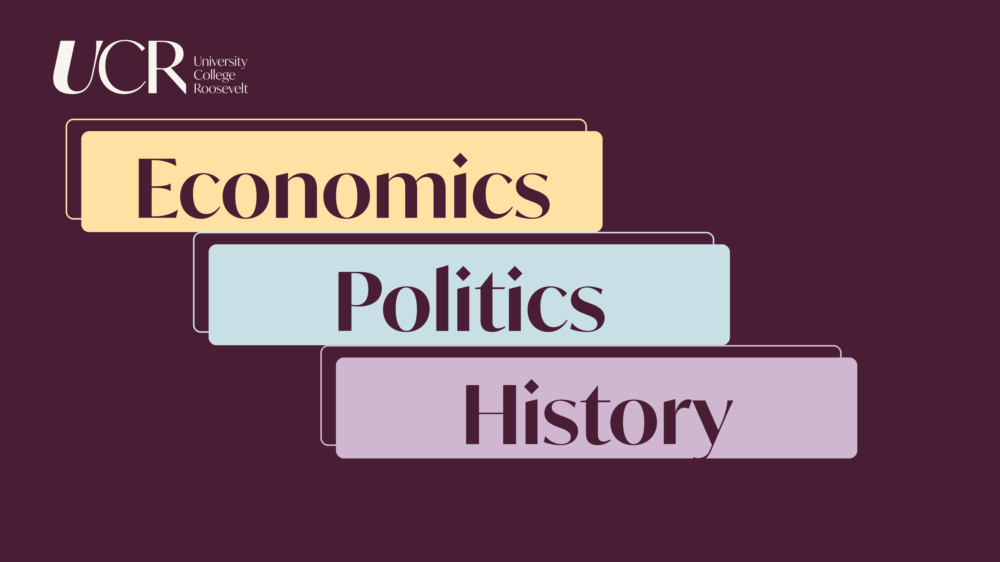

# YouTube thumbnail and metadata prototype

This draft accompanies the [third curriculum-video review cut](../README.md#16-third-review-cut--22-november-2026) and uses the public [Economics, Politics and Global Development example](../../../data/examples/p-001.json), programme `ucr-depth`. The copy presents it as an illustrative programme and follows the [series editorial decisions](../README.md#17-publication-quality-editorial-check-for-a-video-series--22-november-2026) and [YouTube calls to action](../README.md#21-youtube-calls-to-action--22-november-2026). The current review cut uses the Alba synthetic narrator.

## Thumbnail mockups

| Disciplines | Build your own degree | Hybrid |
| --- | --- | --- |
| <a href="01-disciplines.png"></a> | <a href="02-build-your-degree.png"></a> | <a href="03-hybrid.png"></a> |
| Three subject blocks carry the opening animation's visual language onto the cover. | A course card moves toward an open slot in a simplified six-semester grid. | Three subject colours feed into one grid. The cover shows what it means to combine the fields in the title. |

Start with the **hybrid**. It identifies the academic fields and shows how they come together. The disciplines version is the quickest to read at very small sizes. The programme-building version lets the title supply the subjects.

The mockups use the UCR wordmark, IvyMode and the film’s colour palette. The simplified cards depict the six-semester structure. For future videos, keep the UCR identity and choose the dominant disciplines and artwork from the example’s actual academic story.

## Recommended YouTube title

> Economics, Politics and History in One Degree | UCR

## YouTube description opening

Why do some countries become rich while others stay poor? This example brings together economics, politics and history to explore how markets, institutions and historical change shape prosperity.

See how University College Roosevelt (UCR) builds an illustrative six-semester Liberal Arts and Sciences programme around those interests. Tell UCR what you want to study to request your own illustrative curriculum at https://ucr.nl/tell-us-about-your-interests/

## Proposed pinned comment

Which academic interests would you like to combine? Share them in the comments. Your combination could inspire a future video.

## Reproduce the mockups

With Pillow 13.0.0 installed, run this command from the repository root.

```bash
python pilot/curriculum-video/_youtube-prototype/render-thumbnails.py
```

The three PNGs are 3840 × 2160 and under 2 MB each. Review included previews at 320 and 160 pixels wide with a simulated YouTube duration badge. [YouTube thumbnail guidance](https://support.google.com/youtube/answer/72431)
