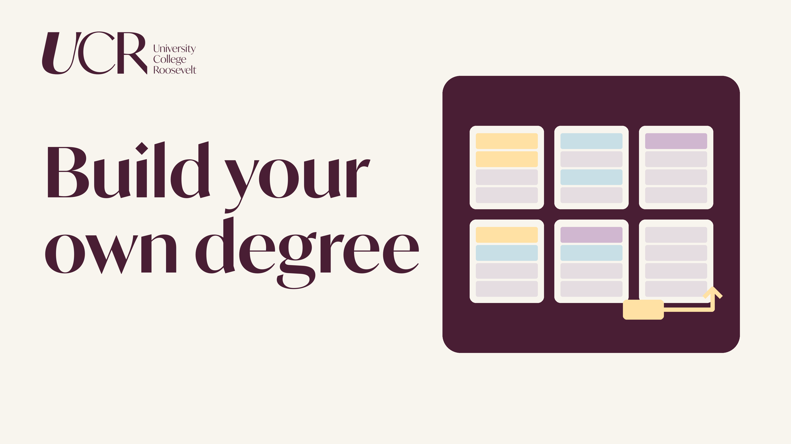
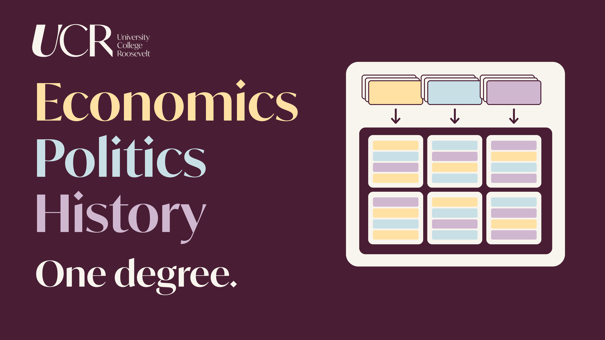

# YouTube thumbnail and metadata prototype

This draft accompanies the [third curriculum-video review cut](../README.md#16-third-review-cut--22-november-2026) and uses the public [Economics, Politics and Global Development example](../../../data/examples/p-001.json), programme `ucr-depth`. The copy presents it as an illustrative programme and follows the [series editorial decisions](../README.md#17-publication-quality-editorial-check-for-a-video-series--22-november-2026) and [YouTube calls to action](../README.md#21-youtube-calls-to-action--22-november-2026). The current review cut uses the Alba synthetic narrator.

## Thumbnail mockups

| Disciplines | Build your own degree | Hybrid |
| --- | --- | --- |
| <a href="01-disciplines.png"></a> | <a href="02-build-your-degree.png"></a> | <a href="03-hybrid.png"></a> |
| Three subject blocks carry the opening animation's visual language onto the cover. | A course card moves toward an open slot in a simplified six-semester grid. | Three subject colours feed into one grid. The cover shows what it means to combine the fields in the title. |

**Approved direction: hybrid (`03-hybrid.png`).** It identifies the academic fields and shows how they come together. Retain the other mockups as alternatives and test the selected design at normal mobile thumbnail size before publication.

The mockups use the UCR wordmark, IvyMode and the film’s colour palette. The simplified cards depict the six-semester structure. For future videos, keep the UCR identity and choose the dominant disciplines and artwork from the example’s actual academic story.

## Recommended YouTube title

> Economics, Politics and History in One Degree | UCR

## Approved YouTube description

Can economics, politics and history come together in one degree?

At University College Roosevelt (UCR), students can combine academic interests across disciplines to create a personalized Liberal Arts and Sciences curriculum.

In this video, we follow an example of a student interested in economics, politics, and why some countries become rich while others remain poor. We show how courses in economics, politics, history and sustainability can come together in one illustrative six-semester programme.

The result demonstrates how different disciplines can contribute to understanding a question that interests a particular student.

What would your curriculum look like?

Tell us about your interests, and we'll show you what a personalized UCR curriculum could look like:

https://ucr.nl/tell-us-about-your-interests/

Alternatively, share your academic interests in the comments. Your combination might inspire one of our next videos.

About UCR

University College Roosevelt is an English-taught Liberal Arts and Sciences college in Middelburg, the Netherlands, affiliated with Utrecht University.

About this video

This video was developed with the assistance of generative AI. It uses synthetic narration and programmatic animations based on actual UCR course information. The curriculum presented is illustrative.

## Approved pinned comment

Which academic interests would you like to combine? Share them in the comments. Your combination could inspire a future video.

## Reproduce the mockups

With Pillow 13.0.0 installed, run this command from the repository root.

```bash
python pilot/curriculum-video/_youtube-prototype/render-thumbnails.py
```

The three PNGs are 3840 × 2160 and under 2 MB each. Review included previews at 320 and 160 pixels wide with a simulated YouTube duration badge. [YouTube thumbnail guidance](https://support.google.com/youtube/answer/72431)
